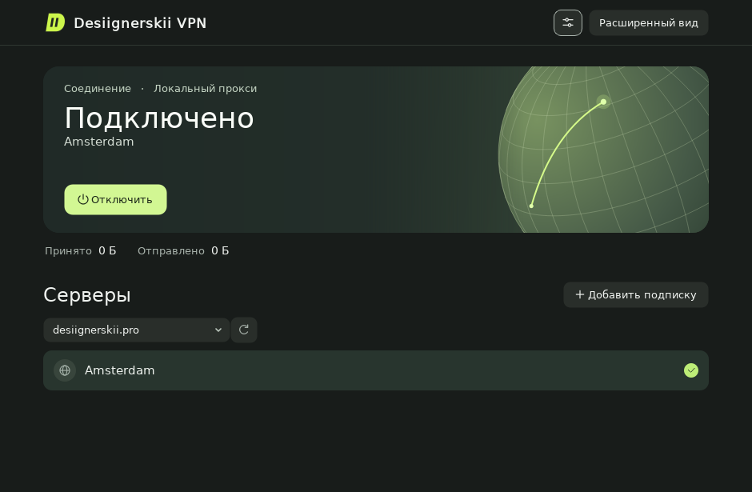

# Desiignerskii VPN

VPN-клиент на базе Throne. Поддерживает несколько подписок, полный туннель (TUN) и отдельные правила для сайтов и приложений.

## Скачать

| Система | Версия 0.6.5 |
| --- | --- |
| Windows 10 и 11, x64 | [Установщик .exe](https://github.com/sorld/desiignerskii-vpn/releases/download/native-v0.6.5/Desiignerskii-VPN-0.6.5-Setup-x64.exe) |
| Ubuntu, x86-64 | [Пакет .deb](https://github.com/sorld/desiignerskii-vpn/releases/download/native-v0.6.5/Desiignerskii-VPN-0.6.5-linux-amd64.deb) |

## Подключение

Откройте приложение и нажмите **Добавить подписку**. Вставьте ссылку из личного кабинета или от другого VPN-провайдера. Выберите сервер и нажмите кнопку подключения.

[Сайт](https://desiignerskii.pro/) · [Исходный проект Throne](https://github.com/throneproj/Throne) · [Лицензия](LICENSE)
